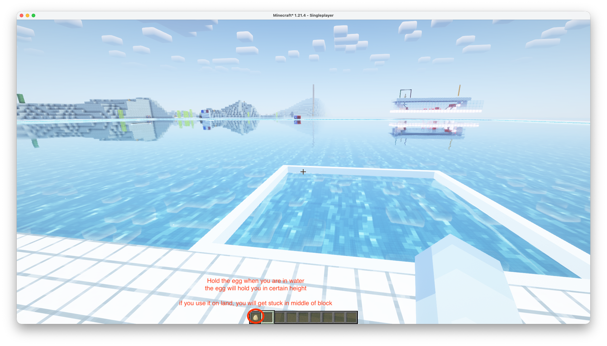

# Automation Workshop

This repository serves as an educational resource for learning different approaches to automation, using Minecraft as a practical example. The Minecraft world simulates the SAUVC competition pool setup, providing a safe and accessible environment for testing automation algorithms.

## Setup

### Prerequisites
- Python 3.12+
- Minecraft Java Edition
- UV package manager (recommended)
- ROS 2

### Installation
```bash
# Clone the repository
git clone https://github.com/Leung-Kam-Ho/SAUVC-Automation-Workshop-Exercises.git
cd SAUVC-Automation-Workshop-Exercises

# Install dependencies
uv sync

# Install the project in editable mode so its src modules are importable
uv pip install -e .
```

### Configure and start the services

The workshop uses two local HTTP services:

For instructions on installing and configuring the Minecraft environment, see the [Minecraft setup guide](media/minecraft%20setup.pdf) in `media/`.

The Minecraft server bundle will be available as `MAUVC_xxxxxxxx.zip` on the project's [GitHub Releases](https://github.com/Leung-Kam-Ho/SAUVC-Automation-Workshop-Exercises/releases) page. Download and set it up by following the included instructions before starting the command server below.

**Minecraft egg control:** In the Minecraft environment, hold the egg while in water to maintain a set depth. Do not use the egg on land, as it can leave the player stuck inside a block. See the [egg control screenshot](media/egggggg.png).



1. **Minecraft command server** — translates HTTP movement/camera commands into keyboard input. Start it in a terminal:
   ```bash
   uv run src/Minecraft_Tool/minecraft_command_server.py
   ```
   It listens on port `25565`. Keep Minecraft open and focused so the simulated keyboard input reaches the game. The server and modpack are currently available to workshop participants only.

2. **YOLO detection server** — required for computer-vision exercises. Setup OBS Virtual Camera for streaming Minecraft as a virtual camera, then start the server:
   ```bash
   uv run src/YOLO_Tool/yolo_server.py --camera-idx 0
   ```
   Change `0` to the OBS Virtual Camera index; if it does not work, try another index such as `1` or `2`. The server updates `media/camera_preview.jpg` every second with the latest annotated YOLO output, so you can confirm it is using the correct camera and inspect detections. The server loads `models/best.pt`, serves detections at `http://localhost:4001/detection_info`, and provides an annotated camera stream at `http://localhost:4001/video_feed`. The current inference code uses Apple's MPS device, so the YOLO server requires a compatible Apple Silicon/macOS environment.

The scripts read service addresses from `user.cfg`. The default Minecraft address is `http://localhost:25565`. For local YOLO inference, set `yolo_url` to `http://localhost:4001/detection_info`; it may be changed to another host if the detector runs on a separate machine. Start the relevant server(s) before running the automation script. The YOLO exercise requires both services.


## Getting Started

1. **Start the Minecraft Command Server** as described above (and the YOLO server for Level 3).

2. **Run Script-Based Automation:**
   ```bash
   uv run src/Automation_Script/Script_Based_Auto.py
   ```

3. **Explore Behaviour Trees:**
   Run `uv run src/Automation_Script/BehaviourTree_Based_Auto.py` to see the Level 2 sequence. It initializes the world, switches camera views, moves forward, turns 180 degrees, and moves forward again. It renders the tree artifacts under `media/`.

4. **Add Computer Vision:**
   Start the YOLO detection server, then run `uv run python src/Automation_Script/YOLO_BehaviourTree_Based_Auto.py`. The current Level 3 file is a scaffold; configure its tree as described below before expecting it to navigate.

## Workshop Levels

### 1. Script-Based Automation

Learn the fundamentals of automation through direct scripting. This approach involves writing sequential commands to control game actions.

**Key Files:**
- `src/Automation_Script/Script_Based_Auto.py` - Demonstrates basic script-based automation with movement sequences
- `src/Minecraft_Tool/minecraft_override_config.py` - Client library for sending commands to Minecraft

**Challenges:**
- **Implement additional movement patterns**
- **The arena environment is fixed**
- **Use Behaviour Tree based logic to walk through the Gate, perform a 180 degrees U-turn, then pass through the gate one more time**

### 2. Behaviour Tree Based Automation (SAUVC Qualification Round)
Advance to more sophisticated automation using behaviour trees. This approach provides better structure and modularity for complex decision-making processes.

***Behaviour Tree for this level:***


***Minecraft Environment for this level:***

https://github.com/user-attachments/assets/97940003-0a4a-4ccc-9501-094fe3015cd2


***SAUVC 2025 Qualification Round Footage:***

https://github.com/user-attachments/assets/66ffdf3e-b37d-47a9-95f1-b71e3dbc51e9


**Key Files:**
- `src/Automation_Script/BehaviourTree_Based_Auto.py` - Runs a scripted behaviour-tree movement sequence
- `src/Automation_Script/custom_action.py` - Movement, yaw, camera, detection-check, and detection-guided steering behaviours
   
**Challenges:**
- **Implement additional action nodes and composite nodes**
- **The arena environment is fixed**
- **Use Behaviour Tree based logic to walk through the Gate, perform a 180 degrees U-turn, then pass through the gate one more time**

**Dependencies:**
- `py-trees` - For behaviour tree logic


### 3. YOLO + Behaviour Tree Automation
Combine computer vision with behaviour trees for intelligent automation. Use YOLO (You Only Look Once) object detection to perceive the game environment and make decisions accordingly.

***Behaviour Tree for this level:***


***Minecraft Environment for this level:***

https://github.com/user-attachments/assets/31a0e1be-5e8b-4d7f-99fe-687d278e4884


***SAUVC 2025 Competition Rounds Footage:***

https://github.com/user-attachments/assets/701894db-2eab-4a89-bbbf-bb3235ea5838

**Key Files:**
- `src/Automation_Script/YOLO_BehaviourTree_Based_Auto.py` - Behaviour-tree scaffold and commented navigation example for YOLO automation
- `src/YOLO_Tool/yolo_server.py` - Camera capture, YOLO inference, detection JSON endpoint, and annotated video feed
- `src/YOLO_Tool/get_detect_info.py` - Client helper for reading detections from the configured YOLO endpoint
- `models/best.pt` - YOLO weights used by the detection server

**Challenges:**
- **Integrate YOLO object detection into the behaviour tree**
- **Implement additional action nodes and composite nodes**
- **The arena environment may vary, requiring dynamic decision-making**
- **Use YOLO + Behaviour Tree based logic to walk through the Gate, go to the blue pail (bucket)**

**Dependencies:**
- `ultralytics` - YOLO implementation for object detection
- `py-trees` - For behaviour tree logic
- `flask` - HTTP services for Minecraft control and YOLO detections
- `pynput` - Simulated keyboard input for Minecraft control

> **Note:** `src/Automation_Script/YOLO_BehaviourTree_Based_Auto.py` currently contains an empty active behaviour-tree sequence. The longer gate-and-pail navigation example in that file is provided as commented reference code; build/configure the tree before expecting it to perform a course run.

## Project Structure
```
├── src/Automation_Script/
│   ├── Script_Based_Auto.py             # Level 1: Script-based automation example
│   ├── BehaviourTree_Based_Auto.py      # Level 2: Behaviour tree-based automation example
│   ├── YOLO_BehaviourTree_Based_Auto.py # Level 3: YOLO + behaviour tree example
│   └── custom_action.py               # Custom behaviour-tree actions
├── src/Minecraft_Tool/
│   ├── minecraft_command_server.py    # Flask server for Minecraft control
│   └── minecraft_override_config.py    # Client library for server communication
├── src/YOLO_Tool/
│   ├── yolo_server.py                 # Camera capture and YOLO detection HTTP server
│   └── get_detect_info.py             # Detection endpoint client
├── models/best.pt                     # YOLO model weights
├── main.py                            # Basic project entry point
├── user.cfg                           # Local service endpoint configuration
├── pyproject.toml                     # Project configuration
└── README.md                          # This file
```


## Learning Objectives

By completing this workshop, you'll learn:
- Basic scripting for automation tasks
- Behaviour tree design patterns
- Computer vision integration with YOLO
- ROS-like message passing concepts
- Modular automation architecture

## Contributing

This is an educational repository. Feel free to enhance the examples or add new automation levels while maintaining the progressive learning structure.
