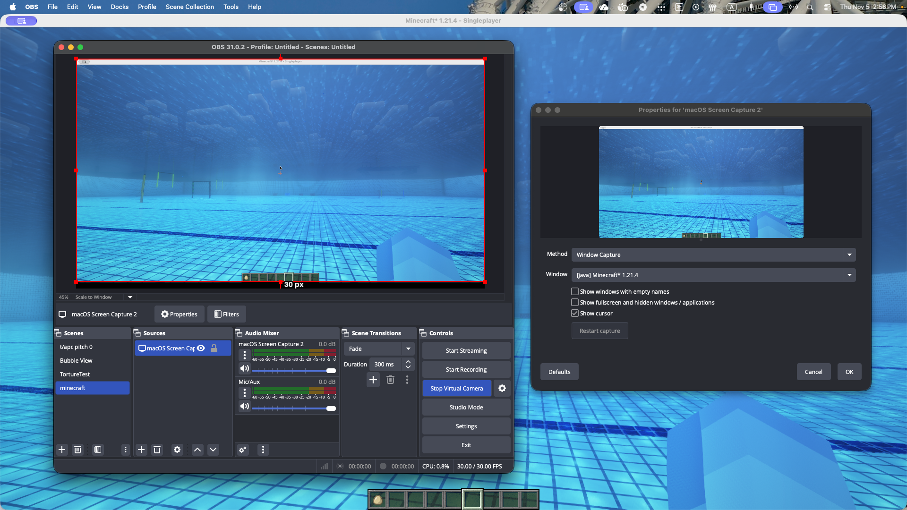

# Automation Workshop

This repository serves as an educational resource for learning different approaches to automation, using Minecraft as a practical example. The Minecraft world simulates the SAUVC competition pool setup, providing a safe and accessible environment for testing automation algorithms.

## Setup

### Prerequisites
- Python 3.12+
- Minecraft Java Edition
- UV package manager (recommended)
- ROS 2

### Installation
```bash
# Clone the repository
git clone https://github.com/Leung-Kam-Ho/SAUVC-Automation-Workshop-Exercises.git
cd SAUVC-Automation-Workshop-Exercises

# Install dependencies and the project in editable mode
uv sync

# Create machine-specific config files from the checked-in examples
cp user.example.cfg user.local.cfg
cp src/vision/config.example.yaml src/vision/config.local.yaml
```

### Configure and start the services

The workshop uses two local HTTP services:

For instructions on installing and configuring the Minecraft environment, see the [Minecraft setup guide](media/minecraft%20setup.pdf) in `media/`.

The Minecraft server bundle will be available as `MAUVC_xxxxxxxx.zip` on the project's [GitHub Releases](https://github.com/Leung-Kam-Ho/SAUVC-Automation-Workshop-Exercises/releases) page. Download and set it up by following the included instructions before starting the command server below.

**Minecraft egg control:** In the Minecraft environment, hold the egg while in water to maintain a set depth. Do not use the egg on land, as it can leave the player stuck inside a block. See the [egg control screenshot](media/egggggg.png).


1. **Minecraft command server** — translates HTTP movement/camera commands into keyboard input. Start it in a terminal:
   ```bash
   uv run src/minecraft/minecraft_command_server.py
   ```
   It listens on port `25565`. Keep Minecraft open and focused so the simulated keyboard input reaches the game. The server and modpack are currently available to workshop participants only.

2. **Vision service** — provides the camera feed and optionally enables YOLO detection, pole-label OCR, TCP streaming, and video recording. For computer-vision exercises, in OBS add a Window Capture source for the Minecraft window (shown as `[java] Minecraft* 1.21.4` in the screenshot), then start OBS Virtual Camera. Once the game feed is visible in OBS, set `camera.index` in `src/vision/config.local.yaml` to the OBS Virtual Camera's camera index and start the service:

   

   ```bash
    uv run python src/vision/vision_service.py --config src/vision/config.local.yaml
   ```

    If the camera does not open, try another `camera.index` (for example, `0`, `1`, or `2`). Edit your local YAML file to adjust camera settings and enable or disable features. The example config enables YOLO with `models/best.pt` and Apple's `mps` device; change `yolo.device` if running on a different platform. With YOLO enabled, detection results are available at `http://localhost:4001/detection_info`; `/video_feed` serves the camera feed (annotated when YOLO is enabled, raw otherwise).

    To run a basic camera-only service without the YAML config, use `uv run python src/vision/vision_service.py`; this serves the raw camera at `/video_feed` with YOLO, OCR, TCP streaming, and recording disabled.

    See [`config.example.yaml`](src/vision/config.example.yaml) for available settings; your machine-specific settings belong in the ignored `config.local.yaml`. Each optional feature is enabled by adding its YAML section: `yolo` enables inference and detections, `ocr` posts recognized pole labels to `pole_url` and saves timestamped snapshots, and `stream` enables TCP frame streaming when `enabled: true` (default target port `5003`) and can also configure segmented MP4 recording. Without an `ocr` or `yolo` section, that feature is disabled. OCR additionally requires the Tesseract executable and the Python `pytesseract` package.

The Minecraft client and detection helper read service addresses from the ignored, machine-specific `user.local.cfg`. Create it from [`user.example.cfg`](user.example.cfg). The example defaults to `http://localhost:25565` for Minecraft and `http://localhost:4001/detection_info` for local YOLO detections; edit those values if a service runs on another machine. Start the relevant service(s) before running the automation script. The YOLO exercise requires the Minecraft command server and the vision service with YOLO enabled.


## Getting Started

1. **Start the Minecraft Command Server** as described above (and the vision service with YOLO enabled for Level 3).

2. **Run Script-Based Automation:**
   ```bash
   uv run src/automation_scripts/level_1_scripted.py
   ```

3. **Explore Behavior Trees:**
   Run 
   ```
   uv run src/automation_scripts/level_2_behavior_tree.py
   ```
   to see the Level 2 sequence. It initializes the world, switches camera views, moves forward, turns 180 degrees, and moves forward again. It renders the tree artifacts under `media/`.

4. **Add Computer Vision:**
   Start the vision service with YOLO enabled in `src/vision/config.local.yaml`, then run
   ```
   uv run python src/automation_scripts/level_3_yolo_behavior_tree.py
   ```
   The current Level 3 file is a scaffold; configure its tree as described below before expecting it to navigate.

## Workshop Levels

### 1. Script-Based Automation

Learn the fundamentals of automation through direct scripting. This approach involves writing sequential commands to control game actions.

**Key Files:**
- `src/automation_scripts/level_1_scripted.py` - Demonstrates basic script-based automation with movement sequences
- `src/minecraft/minecraft_override_config.py` - Client library for sending commands to Minecraft

**Challenges:**
- **Implement additional movement patterns**
- **The arena environment is fixed**
- **Use behavior-tree logic to walk through the gate, perform a 180-degree U-turn, then pass through the gate one more time**

### 2. Behavior Tree-Based Automation (SAUVC Qualification Round)
Advance to more sophisticated automation using behavior trees. This approach provides better structure and modularity for complex decision-making processes.

***Behavior Tree for this level:***


***Minecraft Environment for this level:***

https://github.com/user-attachments/assets/97940003-0a4a-4ccc-9501-094fe3015cd2


***SAUVC 2025 Qualification Round Footage:***

https://github.com/user-attachments/assets/66ffdf3e-b37d-47a9-95f1-b71e3dbc51e9


**Key Files:**
- `src/automation_scripts/level_2_behavior_tree.py` - Runs a scripted behavior-tree movement sequence
- `src/automation_scripts/actions.py` - Movement, yaw, camera, detection-check, and detection-guided steering behaviors
   
**Challenges:**
- **Implement additional action nodes and composite nodes**
- **The arena environment is fixed**
- **Use behavior-tree logic to walk through the gate, perform a 180-degree U-turn, then pass through the gate one more time**

**Dependencies:**
- `py-trees` - For behavior-tree logic


### 3. YOLO + Behavior Tree Automation
Combine computer vision with behavior trees for intelligent automation. Use YOLO (You Only Look Once) object detection to perceive the game environment and make decisions accordingly.

***Behavior Tree for this level:***


***Minecraft Environment for this level:***

https://github.com/user-attachments/assets/31a0e1be-5e8b-4d7f-99fe-687d278e4884


***SAUVC 2025 Competition Rounds Footage:***

https://github.com/user-attachments/assets/701894db-2eab-4a89-bbbf-bb3235ea5838

**Key Files:**
- `src/automation_scripts/level_3_yolo_behavior_tree.py` - Behavior-tree scaffold and commented navigation example for YOLO automation
- `src/vision/vision_service.py` - Unified camera service with optional YOLO, OCR, TCP streaming, and recording
- `src/vision/config.local.yaml` - Ignored, machine-specific camera and YOLO service settings (copied from the example)
- `src/vision/config.example.yaml` - Example configuration for available service features
- `src/vision/get_detect_info.py` - Client helper for reading detections from the configured YOLO endpoint
- `models/best.pt` - YOLO weights used by the detection server

**Challenges:**
- **Integrate YOLO object detection into the behavior tree**
- **Implement additional action nodes and composite nodes**
- **The arena environment may vary, requiring dynamic decision-making**
- **Use YOLO + behavior-tree logic to walk through the gate and go to the blue pail (bucket)**

**Dependencies:**
- `ultralytics` - YOLO implementation for object detection (enabled when the config has a `yolo` section)
- `py-trees` - For behavior-tree logic
- `flask` - HTTP services for Minecraft control and the vision service
- `pynput` - Simulated keyboard input for Minecraft control

> **Note:** `src/automation_scripts/level_3_yolo_behavior_tree.py` contains a sample gate-and-pail navigation tree. Treat it as a workshop starting point: configure the local vision service and tune the movement and detection settings for your environment before expecting it to complete a course run.

## Project Structure
```
├── src/
│   ├── automation_scripts/
│   │   ├── level_1_scripted.py              # Level 1: Script-based automation
│   │   ├── level_2_behavior_tree.py         # Level 2: Behavior-tree automation
│   │   ├── level_3_yolo_behavior_tree.py    # Level 3: YOLO + behavior tree
│   │   └── actions.py                       # Reusable behavior-tree actions
│   ├── minecraft/
│   │   ├── minecraft_command_server.py      # Flask server for Minecraft control
│   │   └── minecraft_override_config.py     # Client library for server communication
│   └── vision/
│       ├── vision_service.py                # Camera, YOLO, OCR, streaming, and recording
│       ├── config.example.yaml              # Example vision-service configuration
│       ├── config.local.yaml                # Local config; ignored by Git
│       └── get_detect_info.py               # Detection endpoint client
├── models/best.pt                           # YOLO model weights
├── media/                                   # Workshop images, guide, and tree diagrams
├── user.example.cfg                         # Example service endpoints
├── user.local.cfg                           # Local endpoints; ignored by Git
├── main.py
├── pyproject.toml
└── README.md
```


## Learning Objectives

By completing this workshop, you'll learn:
- Basic scripting for automation tasks
- Behavior tree design patterns
- Computer vision integration with YOLO
- ROS-like message passing concepts
- Modular automation architecture

## Contributing

This is an educational repository. Feel free to enhance the examples or add new automation levels while maintaining the progressive learning structure.
